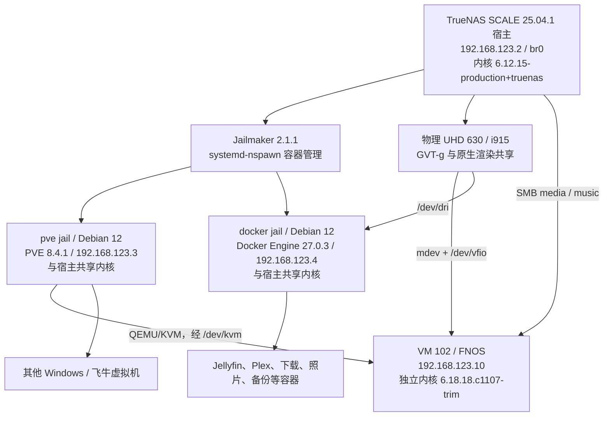

# TrueNAS、Jailmaker、PVE 与飞牛系统环境总览

核对日期：2026-10-09。本文依据实际机器的只读检查整理，供后续维护、排障及向他人说明环境使用。版本、地址、运行状态和存储容量均为核对时快照，不代表长期固定值。未记录密码、令牌或应用环境变量。

## 1. 架构与边界



- TrueNAS 是真正的物理宿主，负责物理设备、宿主内核、ZFS 和 Jailmaker。
- `pve` 与 `docker` 是 systemd-nspawn 容器，不是拥有独立内核的 VM。PVE 显示 TrueNAS 内核版本是正常的。
- PVE jail 内的 QEMU 使用宿主 `/dev/kvm` 提供硬件虚拟化；这不是“先运行一个 PVE VM，再做嵌套虚拟化”。
- 飞牛 VM 102 是真正的虚拟机，有独立内核和设备驱动；来宾 i915 参数不会从宿主自动继承。
- 两个 jail 配置中均包含宿主桥接 netfilter 设置。PVE 实际启动还有 `--capability=all`，所以不能把这些 jail 视为与宿主完全隔离的安全边界。

## 2. 物理宿主

| 项目 | 实际配置 |
| --- | --- |
| 系统 | TrueNAS SCALE `25.04.1` |
| 主机名 | `truenas` |
| 内核 | `6.12.15-production+truenas` |
| CPU | Intel Core i5-9600T，6 核、6 线程 |
| 内存 | 系统报告约 125 GiB 可用物理内存总量 |
| 核显 | Intel UHD Graphics 630，`8086:3e92` |
| GPU PCI 地址 | `0000:00:02.0` |
| GPU 宿主驱动 | `i915` |
| 网络 | `br0`，`192.168.123.2/24` |
| SSH 入口 | `ssh nas`，当前登录用户 `julen`，管理命令使用 `sudo` |
| Jailmaker 版本 | `2.1.1` |
| Jailmaker 根目录 | `/mnt/app/jailmaker` |

GPU 相关宿主启动参数包括 `intel_iommu=on iommu=pt i915.enable_gvt=1 i915.enable_guc=0`。不要因来宾 GPU 故障把物理核显绑定到 `vfio-pci`，否则会破坏现有共享路径。

## 3. Jailmaker 容器

| 容器 | 系统 | 地址 | 主要职责 | 配置 startup | 核对时状态 |
| --- | --- | --- | --- | --- | --- |
| `pve` | Debian 12 bookworm | `192.168.123.3` | PVE、QEMU/KVM、VM 管理 | `0` | 运行中 |
| `docker` | Debian 12 bookworm | `192.168.123.4` | Docker 应用 | `1` | 运行中 |

配置分别位于 `/mnt/app/jailmaker/jails/pve/config` 与 `/mnt/app/jailmaker/jails/docker/config`。宿主服务为 `jlmkr-pve.service` 和 `jlmkr-docker.service`，当前是 Jailmaker 创建的 transient 单元。

### PVE jail 映射

| 宿主资源 | jail 内资源 | 用途 |
| --- | --- | --- |
| `br0` | `host0` 接入 PVE `vmbr0` | 外部网络与 VM 桥接 |
| `/dev/kvm` | `/dev/kvm` | KVM |
| `/dev/vfio` | `/dev/vfio` | 使用宿主创建的 mdev |
| `/dev/fuse` | `/dev/fuse` | FUSE |
| `/dev/vsock`、`/dev/vhost-vsock` | 同名路径 | vsock |
| `/mnt/app/vm-data` | `/vm-data` | 虚拟磁盘、ISO 等 |
| `/mnt/data` | `/mnt/data` | 宿主数据目录访问 |

PVE jail 不直接映射 `/dev/dri`。GVT-g mdev 的创建/删除由 TrueNAS 宿主的 jail 钩子执行，不能让 PVE 为此写入宿主 sysfs。

### Docker jail 映射

实际 systemd-nspawn 启动参数包含 `--bind=/dev/dri`，Jellyfin 容器再把 jail 的 `/dev/dri` 映射进自身，权限为 `rwm`。

| 宿主目录 | Docker jail 内目录 |
| --- | --- |
| `/mnt/app/docker-data` | `/data` |
| `/mnt/data/music` | `/mnt/data/music` |
| `/mnt/media16/media` | `/mnt/media/media` |

Docker Engine 为 `27.0.3`，存储驱动为 `overlay2`，Engine 报告的数据根目录是 `/var/lib/docker`。不要仅凭 `/data` bind 就认定 Engine 数据根目录在 `/data`；本次未进一步确认是否有符号链接或其他存储安排。

## 4. 网络与管理入口

| 层级 | 地址/接口 | 说明 |
| --- | --- | --- |
| LAN 网关 | `192.168.123.1` | PVE 网络配置记录的网关 |
| TrueNAS | `192.168.123.2` / `br0` | 宿主管理、SMB |
| PVE jail | `192.168.123.3` / `vmbr0` | PVE 管理、VM 网络桥 |
| Docker jail | `192.168.123.4` | Docker 应用网络 |
| 飞牛 VM 102 | `192.168.123.10` / `enp6s18` | VirtIO 网卡接入 `vmbr0` |

PVE `vmbr0` 的上联为 jail 的 `host0`，Jailmaker 再接到宿主 `br0`。

## 5. PVE 虚拟机清单

PVE Manager 版本为 `8.4.1/2a5fa54a8503f96d`。所有下列 VM 配置的 CPU 类型均为 `host`；分配 vCPU 数不代表物理独占核心。

| VMID | 名称 | vCPU | 内存 | 磁盘配置 | 核对时状态 | onboot |
| --- | --- | ---: | ---: | --- | --- | --- |
| 100 | `win10-ltsc-2019` | 4 | 4096 MiB | 32 GiB | 停止 | 未显式设置 |
| 102 | `FNOS` | 3 | 8192 MiB | 20 GiB + 32 GiB | 运行 | `1` |
| 103 | `win8` | 8 | 4096 MiB | 16 GiB | 停止 | 未显式设置 |
| 107 | `download-win10` | 3 | 4096 MiB | 32 GiB | 运行 | `1` |
| 108 | `fnOS` | 1 | 8192 MiB | 32 GiB + 四个 1 GiB | 停止 | 未显式设置 |

虚拟磁盘位于 PVE `vm-data` 存储下，已检查条目为 qcow2。VM 100、103、107 配置 `bios: ovmf`；VM 102 使用 `q35`，没有显式 `bios` 项。本次仅进入 VM 102 检查来宾，其他 VM 名称和系统类型来自 PVE 配置，不等于核验了实际安装版本。

`onboot=1` 是 PVE 层的设置，不能代替 Jailmaker 的启动设置。尤其 `pve` jail 当前 `startup=0`，不要假设宿主重启后 PVE 一定由 Jailmaker 自动拉起；是否存在其他启动任务，本次未核实。

## 6. 飞牛 VM 102

| 项目 | 实际值 |
| --- | --- |
| PVE 名称 / 来宾主机名 | `FNOS` / `fn` |
| 基础发行版标识 | `/etc/os-release` 报告 Debian 12 bookworm |
| 实际来宾内核 | `6.18.18.c1107-trim` |
| QEMU guest agent | 已配置，能执行诊断命令 |
| 系统文件系统 | `/dev/sda2` 挂载 `/`，ext4 |
| 来宾数据卷 | `/vol1`，device-mapper 设备，ext4 |
| 虚拟核显 | `0000:01:00.0`，UHD 630，驱动 i915 |
| 渲染节点 | `/dev/dri/renderD128` |
| 持久 GuC 配置 | `/etc/modprobe.d/i915-gvtg.conf`：`options i915 enable_guc=0` |


飞牛通过 SMB 访问宿主数据，不是把媒体目录直接当作虚拟磁盘

## 7. GPU 共享与已知修复

物理 UHD 630 始终由 TrueNAS `i915` 管理，存在两条并行使用路径：

1. TrueNAS `/dev/dri` -> Docker jail -> Jellyfin 容器，原生访问物理渲染节点。
2. TrueNAS 创建 GVT-g mdev -> PVE `/dev/vfio` -> QEMU -> 飞牛来宾 i915。

当前确认的 mdev 属于 VM 102 `hostpci0`，不是 VM 107：

```text
hostpci0: 0000:00:02.0,mdev=i915-GVTg_V5_4,pcie=1
UUID: 00000000-0000-0000-0000-000000000102
```

PVE jail `pre_start_hook` 幂等创建该 UUID，`post_stop_hook` 删除它。停止 jail 前应先正常停止 VM，否则会中断来宾；物理 GPU、mdev 和原生转码共享资源，不能按 VM 分配简单视为独立显卡。

该飞牛模块默认 `enable_guc=-1` 会选择有效值 `2`，GuC GGTT 保留区与 GVT-g balloon 区冲突，导致 i915 初始化 `-28`。已在来宾持久设置 `0` 并更新当前内核 initramfs，详情见 [飞牛 GuC 修复记录](FNOS_GVT_G_GUC_FIX.md)。

本次核对来宾启动时间为 `2026-10-09 12:18:39`，新启动日志显示 i915 初始化成功，当前 GuC 为 `0`、渲染节点存在。这是修复记录创建后的新启动验证证据；本文检查过程中没有重启来宾或修改配置。本轮未重跑完整编解码负载，前序诊断已验证 H.264 VAAPI 硬件编码/解码及宿主 Jellyfin 硬件编码。

SAGV、power-well 和宿主 PM 引用告警是另外的兼容性问题，不能仅凭告警认定物理 GPU 损坏。GVT-g 已停止维护且存在安全风险，只分配给可信 VM。


## 8. 常用只读排障入口

### TrueNAS 宿主

```bash
ssh nas
uname -r
sudo machinectl list --no-pager
sudo lspci -Dnnk -s 0000:00:02.0
sudo journalctl -k -b --no-pager | grep -Ei 'i915|gvt|kvmgt|GPU HANG'
```

### 经宿主进入 jail

```bash
sudo /mnt/app/jailmaker/jlmkr.py exec pve sh -c 'pveversion; qm list'
sudo /mnt/app/jailmaker/jlmkr.py exec docker sh -c 'docker ps'
```

### 经 PVE guest agent 检查飞牛

在 TrueNAS 上执行以下命令。保留外层 `sh -c`，避免 Jailmaker 参数解析影响 `qm guest exec` 的 `--` 分隔符。

```bash
sudo /mnt/app/jailmaker/jlmkr.py exec pve sh -c \
  'qm guest exec 102 -- /bin/sh -c "uname -r; cat /sys/module/i915/parameters/enable_guc; ls -l /dev/dri"'
```

## 9. 后续维护时应更新的项目

- TrueNAS、Jailmaker、PVE、飞牛实际版本和内核。
- 网络地址、jail 启动配置、VM 启动配置及资源分配。
- 新内核 initramfs 是否包含来宾 `enable_guc=0` 配置。
- ZFS 池健康、冗余布局、备份目标、最近成功备份和恢复验证。
- Docker 镜像实际版本、应用健康、数据根目录和设备映射。

相关文档：[GVT-g 操作手册](TRUENAS_GVT_G_MAINTENANCE.md)、[飞牛 GuC 故障与修复](FNOS_GVT_G_GUC_FIX.md)。操作手册含历史环境示例，实际环境以本总览核对值及实时检查为准。